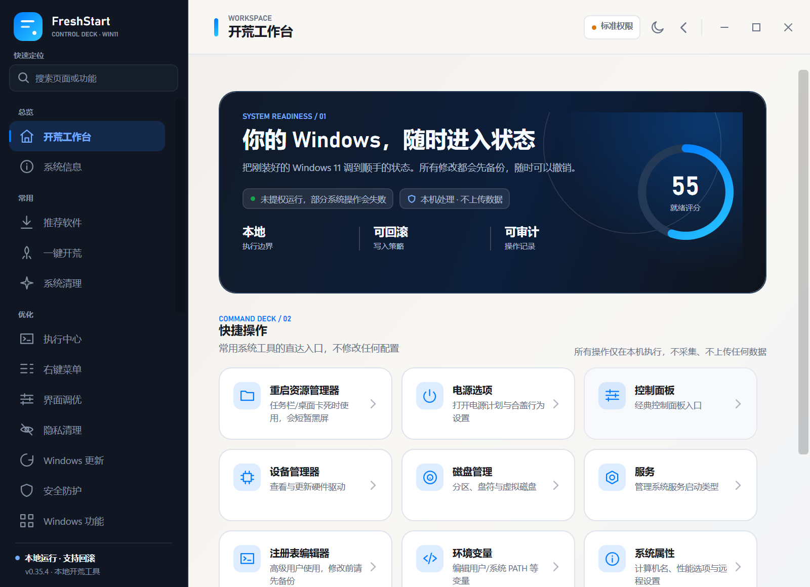
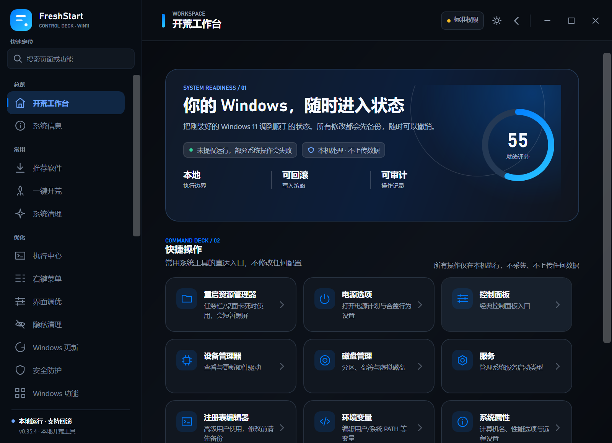
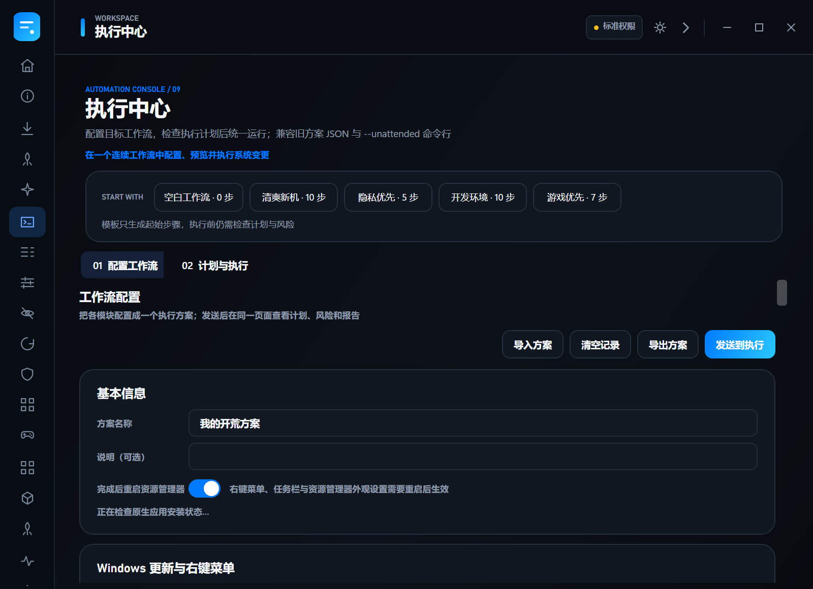
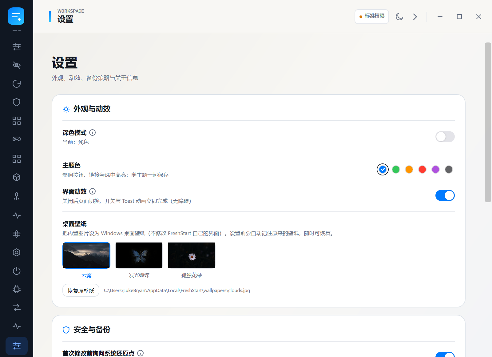

# FreshStart

**把刚装好的 Windows 11 调整到顺手、干净、可回滚的状态。**

FreshStart 是一个本地优先的 Windows 11 桌面工具，集中处理系统信息、常用设置、隐私、软件、服务、备份与自动化工作流。除明确标注为不可回滚的项目外，写操作遵循“读取当前值 → 备份 → 写入 → 校验 → 失败回滚”的流程。

**当前版本：0.1.0** · Windows 11 · .NET 8 · WPF



## 功能

| 模块 | 能力 |
|---|---|
| 开荒工作台 | 系统就绪评分、常用系统工具入口、环境状态 |
| 系统信息 | CPU、内存、主板、显卡、磁盘、网卡、系统版本与激活状态 |
| 优化与隐私 | Windows 更新、隐私策略、界面调优、Defender、防火墙、可选功能、游戏优化 |
| 软件管理 | winget 安装与升级、官方直链兜底、软件卸载、原生应用管理、残留清理 |
| 系统维护 | 启动项、服务与计划任务、驱动备份、系统清理、全局还原 |
| 执行中心 | 可视化工作流、依赖排序、风险预检、批量执行、取消与 HTML/JSON 报告 |
| 命令执行 | `--execute` 无界面执行方案，支持退出码与兼容旧方案格式 |

完整功能说明见 [FEATURES.md](docs/FEATURES.md)。

## 设计

FreshStart 使用 **Control Deck** 视觉语言：深墨色导航、纸白工作区、系统就绪仪表盘和单一渐变强调色。浅色与深色主题共享同一套信息层级，所有页面支持 980×640 以上的可缩放窗口。

| 浅色 | 深色 |
|---|---|
|  |  |

| 执行中心 | 设置 |
|---|---|
|  |  |

## 安全模型

- 注册表写入必须通过路径白名单。
- 写操作先生成 JSON 快照，高风险操作可按策略创建系统还原点。
- 写入或读回校验失败时自动尝试逆序回滚。
- 操作历史、备份与日志只保存在本机 `%AppData%\FreshStart`。
- 不采集遥测，不上传用户数据，不包含广告或捆绑安装。
- 执行中心只调用软件内置的系统操作，不执行任意脚本或外部命令。

安全边界和已知限制见 [PROJECT-NOTES.md](docs/PROJECT-NOTES.md) 与 [SECURITY.md](SECURITY.md)。

## 环境要求

- Windows 11 22H2 或更高版本
- 管理员权限；发布版首次启动会请求一次 UAC
- 从源码构建需要 .NET SDK `8.0.426` 或兼容的 8.0 Feature Band
- 发布原生启动器建议安装 Visual Studio 2022 C++ 生成工具

## 构建

```powershell
dotnet restore FreshStart.sln
dotnet build FreshStart.sln -c Release
```

不触发 UAC 的开发构建：

```powershell
dotnet build FreshStart.sln -c Debug -p:DevNoElevation=true
src\FreshStart.App\bin\Debug\net8.0-windows\win-x64\FreshStart.Host.exe --page=home
```

生成发布包：

```powershell
powershell -ExecutionPolicy Bypass -File build\publish.ps1
```

详细构建、调试、视觉回归和打包说明见 [DEVELOPMENT.md](docs/DEVELOPMENT.md)。

### winget 策略

FreshStart 不会在启动时强制安装或更新 winget。缺少 winget 或版本过低时，应用仍可正常打开；进入「推荐软件」页后可按需：

1. 从微软官方在线更新 App Installer；
2. 打开 Microsoft Store；
3. 导入提前下载的离线安装包。

完整发布包保持精简，不携带数百 MB 的微软安装包。需要完全离线部署时，可额外下载同一版本的 `winget-offline` 附加包。

## 项目结构

```text
src/
  FreshStart.Core/       设置、日志、备份、写锁与操作管线
  FreshStart.Services/   Registry、WMI、winget、PowerShell 与系统原语
  FreshStart.Modules/    页面、ViewModel、导航目录与自定义控件
  FreshStart.App/        WPF 外壳、主题、对话框、Toast 与启动流程
  FreshStart.Launcher/   NativeAOT 启动器与提权转发
build/                   构建、发布和 UI 回归脚本
docs/                    架构、功能、性能与开发文档
assets/wallpapers/       内置桌面壁纸
```

架构说明见 [ARCHITECTURE.md](docs/ARCHITECTURE.md)，性能数据见 [PERF.md](docs/PERF.md)。

## 仓库与发布

源代码仓库只包含软件本体。Microsoft winget 离线组件超过 GitHub 普通文件限制，因此作为独立 Release 附加包发布；完整离线安装说明见 [assets/winget/README.md](assets/winget/README.md)。

GitHub 的 100 MB 限制仅针对 Git 仓库文件。`FreshStart.Host.exe` 和最终 ZIP
不提交到 Git，而是由 GitHub Actions 构建后上传到 Releases；单个 Release
资产上限为 2 GB，足够承载本项目的安装包。

版本记录见 [CHANGELOG.md](CHANGELOG.md)。

## License

FreshStart 的原创源代码采用 [MIT License](LICENSE)。第三方组件、Microsoft
winget 安装包以及参考 `windows-defender-remover` 的内容继续遵循各自许可证，
不因本项目采用 MIT 而改变。详细归属见
[第三方声明](docs/PROJECT-NOTES.md#第三方软件与引用)。

## 参与贡献

提交前请阅读 [CONTRIBUTING.md](CONTRIBUTING.md)。安全漏洞请通过 GitHub Security Advisories 私下报告，不要创建公开 Issue。
