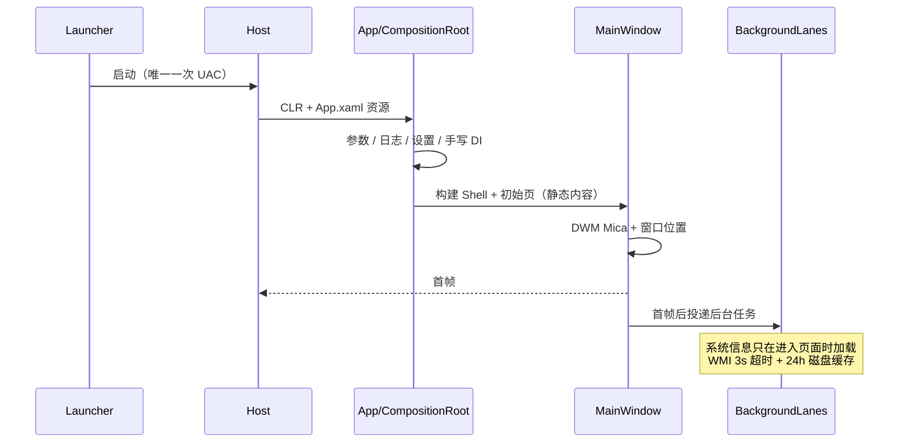

# FreshStart 架构说明（第一批）

## 1. 进程模型

```
用户双击 FreshStart.exe（asInvoker, NativeAOT, ~2MB）
        │
        ├─ 命名管道探测到 Host 已运行 ──► 转发参数 ──► 激活窗口 ──► 退出（热启动 13ms 级）
        │
        └─ 未运行 ──► 启动 FreshStart.Host.exe（app.manifest: requireAdministrator，仅此一次 UAC）
                           │
                           ├─ 命名 Mutex 保证单实例
                           ├─ 命名管道监听后续激活请求
                           └─ WPF 主体
```

- 启动器不读配置、不加载 WPF、不做任何系统修改。
- Host 的 UAC 只在冷启动出现一次；后续重复启动走启动器，不再弹窗。
- 管道名带 SessionId，避免多用户会话互相干扰。

## 2. 分层

```
FreshStart.App (WPF 外壳、主题、对话框、导航)
      │
FreshStart.Modules (页面、ViewModel、可复用控件)
      │
FreshStart.Services (注册表、WMI、还原点、快捷操作)
      │
FreshStart.Core (ISystemOperation、备份、日志、设置、启动埋点)
```

依赖单向，Core 不引用 WPF / Windows 注册表类型。

## 3. 启动时序



启动路径禁止：注册表批量遍历、WMI、进程全量枚举、磁盘扫描、反射程序集扫描。

## 4. 写操作管线

```
IOperationGate 确认（含首次写入的还原点三选一）
  → CaptureCurrentStateAsync（读当前值）
  → JsonBackupStore.SaveAsync（原子写 + SHA256 + 读回校验）
  → [High + 本次会话开启] IRestorePointService.CreateAsync
  → ApplyAsync（写后读回校验）
  → 失败：RollbackAsync（CancellationToken.None，保证回滚不因取消中断）
  → 取消：同样回滚已应用步骤，结果标记 Cancelled + RolledBack
  → 成功：撤销栈 + operations.jsonl 审计
```

- `OperationRunner` 内部 `SemaphoreSlim` 串行化写入，避免并发改注册表/服务。
- `RegistryPathGuard` 白名单在操作构造期即校验，按「前缀 + 分隔符」边界匹配；只覆盖 FreshStart 自身的注册表写入。
- 备份目录命名：`{yyyyMMdd-HHmmss}-{operationId}-{guid8}`，启动时按 `BackupRetentionDays` 清理（至少留 20 份）。
- 未走 `OperationRunner` 的写路径仅 4 条（清理、残留清理、历史回滚、托盘清理）：均有二次确认 + 共用全局写锁（`IWriteLock`），但没有独立备份快照、不写审计。

## 5. 线程与任务

| 通道 | 并发 | 用途 |
|---|---|---|
| UI 线程 | 1 | 组合、绑定、动画；禁止系统 I/O |
| 写操作 | 1 | `OperationRunner` 串行队列 |
| P1 页面数据 | 2 | 系统信息、后续进程/服务枚举；离开页面取消 |
| P2 预热 | 1 | 图标/字体/缓存预热 |

`SystemInfoService` 使用 `Task.Run` + 每项 3s 超时 + 整体 6s 上限；WMI 结果落盘 24h。

## 6. 关键文件

| 文件 | 职责 |
|---|---|
| `Core/Operations/OperationRunner.cs` | 四步管线、回滚、撤销、审计 |
| `Core/Backup/JsonBackupStore.cs` | 原子备份与完整性校验 |
| `Core/Backup/BackupRetention.cs` | 备份与日志保留策略（启动时后台执行） |
| `Core/AppPaths.cs` | 数据目录约定：`backup` / `reports` / `history` / `presets` / `state\baseline` / `cache` / `logs` |
| `Core/Security/RegistryPathGuard.cs` | 注册表白名单（前缀 + 分隔符边界匹配） |
| `Services/Registry/RegistryService.cs` | 值/键/ACL 快照与恢复 |
| `Services/History/HistoryRestoreService.cs` | 历史回滚：备份目录白名单 + SHA256 校验；仅支持注册表值/键与服务启动类型 |
| `Services/System/SystemInfoService.cs` | 快速字段 + WMI 慢字段 + 缓存 |
| `App/Startup/SingleInstanceHost.cs` | Mutex + 命名管道激活 |
| `Modules/Software/SoftwarePage.xaml` | winget 按需检测、在线更新、Microsoft Store 与离线包导入 |
| `App/Services/OperationGate.cs` | 操作确认 + 还原点决策 UI |
| `App/Shell/MainWindow.xaml` | 自绘标题栏、侧边栏、页面容器 |
| `App/Services/WindowMaximizeFix.cs` | 修复 WindowChrome 最大化覆盖任务栏 |

### 第二批新增服务

| 文件 | 职责 |
|---|---|
| `Services/ContextMenu/ContextMenuService.cs` | 枚举 shell 动词 / ContextMenuHandlers / 发送到 / ShellNew；生成操作 |
| `Services/ContextMenu/ContextMenuQuarantine.cs` | 回收站索引（注册表 + 文件），跨重启恢复 |
| `Services/Registry/RegistryKeyMoveOperation.cs` | 注册表键移动（禁用扩展、移入隔离区、恢复） |
| `Services/Startup/StartupService.cs` | Run/RunOnce、启动文件夹、计划任务、第三方自动服务；StartupApproved |
| `Services/Startup/ScheduledTaskService.cs` | 计划任务枚举与启停（PowerShell，隐藏窗口） |
| `Services/Startup/ServiceControlService.cs` | 服务启动类型/DelayedAutoStart（sc.exe + 注册表读回校验） |
| `Services/WindowsUpdate/WindowsUpdateService.cs` | 更新状态、历史、三模式操作（服务 + 策略 + 三处更新任务） |
| `Services/Performance/PerformanceSampler.cs` | CPU/内存/磁盘/网络/GPU 采样；PDH ReadCategory；进程差值 |
| `Services/Appx/AppxService.cs` | Appx 枚举、卸载、重新注册、已卸载记录、批量事务；移除安全中心时清理托盘自启动 |
| `Services/Software/WingetService.cs` | winget 子进程、安装/卸载、失败回滚、自定义来源、已安装索引（winget ID + 注册表名称） |
| `Services/Tuning/TuningService.cs` | 24 项注册表调控定义、4 套预设、批量写入/校验/回滚 |
| `Services/Network/NetworkService.cs` | 适配器/DNS/IPv4 读取、DNS 与静态 IP 配置及快照回滚、刷新缓存、Ping |
| `Services/Power/PowerService.cs` | 电源计划读取（本地化名称）与切换回滚 |
| `Services/Firewall/FirewallService.cs` | 防火墙配置文件开关、规则枚举/添加/删除（先快照） |
| `Services/Features/OptionalFeatureService.cs` | Windows 可选功能枚举与启用/禁用（DISM 接口 + 状态校验） |
| `Services/Driver/DriverService.cs`、`DriverOperations.cs` | 第三方驱动枚举、INF/目录安装、驱动包删除（导出备份回滚） |
| `Services/Defender/DefenderService.cs` | Defender 状态、实时防护/云保护、排除项、临时关闭、安全中心安装状态 |
| `Services/Defender/SecurityCenterTrayOperation.cs` | 移除安全中心托盘自启动（Run 值快照，可回滚） |
| `Services/Defender/DefenderRemovalService.cs`、`DefenderRemovalOperation.cs` | 彻底移除 Defender 引擎（不可回滚）；SYSTEM 计划任务导入注册表、停止服务、删除目录与 SmartScreen |
| `Services/System/SystemProcessRunner.cs` | 一次性 SYSTEM 计划任务执行脚本；失败回退管理员权限 |
| `Services/System/SecureWorkDirectory.cs` | 提权脚本工作目录：随机名 + 仅 SYSTEM/Administrators 可写（防 TOCTOU 提权） |
| `Services/System/PowerShellRunner.cs` | 异步、隐藏、可超时的 PowerShell 执行器 |
| `Core/Backup/BackupRetention.cs` | 按保留天数清理旧备份与按天日志（启动时后台执行） |
| `Services/FileSystem/FileMoveOperation.cs` | 启动文件夹 `.disabled` 与发送到隔离/恢复 |

所有写操作（包括 PowerShell 操作）都通过 `OperationRunner`；PowerShell 仅承担没有稳定 C# API 的读取与命令执行，仍然先捕获状态再写入。

## 7. 后续模块接入方式

1. 在 `Modules` 下新建模块文件夹（ViewModel + View + Operations）。
2. 在 `NavCatalog` 中把对应条目 `IsAvailable` 改为 true。
3. 在 `CompositionRoot` 的工厂字典中注册页面。
4. 所有写入使用 `OperationBase` 派生类，并通过 `OperationRunner.ExecuteAsync` 执行。
5. 新增可写注册表根必须同步更新 `RegistryPathGuard` 白名单，并说明风险。
